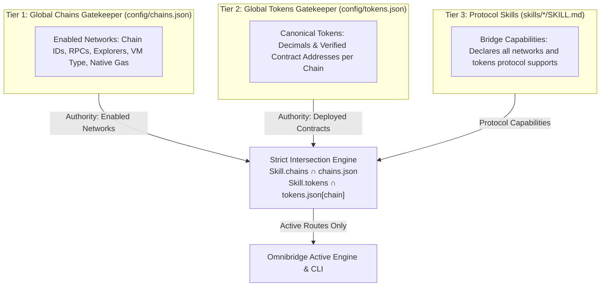

# Developer Guide: Adding Bridges, Chains & Tokens

Omnibridge 2.0 uses a **3-Tier Scalable Registry Architecture** with **Strict Intersection Enforcement** designed to eliminate code duplication, prevent configuration drift, and make extending cross-chain capabilities seamless.



> [!IMPORTANT]
> **Strict Intersection & Single Source of Truth:**
> 1. **`config/chains.json` is the Supreme Authority for Networks**: An Omnibridge instance only recognizes chains enabled in `config/chains.json`. If a chain is removed from `config/chains.json`, all routes for that chain are immediately deactivated across all skills. Skills can never create phantom chains.
> 2. **`config/tokens.json` is the Supreme Authority for Tokens**: A token is only active on a chain if a verified contract address is defined for that chain.
> 3. **Protocol Skills are Declarative Capability Filters**: Skills declare what the protocol supports in the wild. Omnibridge computes the intersection so you never have to prune or edit protocol skill files when enabling or disabling chains locally.
> 4. **Current Scope**: Currently, Omnibridge is configured to exclusively support **USDC** across enabled networks.

---

## Quick Reference Cheat Sheet

| Task | Files to Edit | Typical Effort |
| :--- | :--- | :--- |
| **Enable existing chain on bridge** | `skills/<bridge>/SKILL.md` | 1 line |
| **Add or enable a chain in Omnibridge** | `config/chains.json` + `config/tokens.json` + `SKILL.md` | ~10 lines |
| **Add a new token to Omnibridge** | `config/tokens.json` + `SKILL.md` | ~8 lines |
| **Add a brand new bridge protocol** | Create `skills/<new-bridge>/SKILL.md` | 1 markdown file |

---

## 1. Enabling an Existing Chain on a Bridge

If the network already exists in [`config/chains.json`](../config/chains.json) (e.g., `polygon`, `base`, `arbitrum`, `ethereum`, `optimism`), you only need to add its name to your bridge's `supportedChains` list.

### Step:
Open `skills/<bridge-name>/SKILL.md` and add the chain:

```yaml
supportedChains:
  - polygon
  - base
  - arbitrum
  - optimism      # <-- Just add the chain name (ensure space after hyphen!)
```

> [!IMPORTANT]
> **YAML Syntax Rule**: In YAML, list items **must have a space** after the hyphen (`- optimism`, not `-optimism`). A missing space causes YAML parse errors.

**What happens automatically:**
1. The engine reads `optimism` and pulls its Chain ID, RPC, and explorer from Tier 1.
2. It looks up all active tokens (`USDC`) on `optimism` from Tier 2.
3. It generates all bidirectional route recipes (e.g., `base -> optimism`, `optimism -> arbitrum`). If a chain in `supportedChains` is not present in `config/chains.json`, it is safely ignored without errors.

---

## 2. Adding a Brand New Chain to Omnibridge

When adding a chain the repository hasn't seen before (e.g., `avalanche`, `linea`, `scroll`):

### Step 2.1: Register the Chain in Tier 1 (`config/chains.json`)
Open [`config/chains.json`](../config/chains.json) and add the network object:

```json
"avalanche": {
  "displayName": "Avalanche C-Chain",
  "chainId": 43114,
  "vmType": "evm",
  "nativeToken": {
    "symbol": "AVAX",
    "name": "Avalanche",
    "decimals": 18
  },
  "defaultRpc": "https://api.avax.network/ext/bc/C/rpc",
  "blockExplorer": "https://snowtrace.io"
}
```

#### Chain Schema Fields:
- `displayName` *(string)*: Human-readable name used in CLI tables and audit cards.
- `chainId` *(number)*: Numerical chain ID (`0` for non-EVM chains like Stellar/XRPL).
- `vmType` *(string)*: `'evm'` | `'stellar'` | `'xrpl'`.
- `nativeToken` *(object)*: `symbol`, `name`, `decimals` for the chain's native gas fee asset.
- `defaultRpc` *(string)*: Public or fallback RPC HTTP endpoint.
- `blockExplorer` *(string)*: Base explorer URL (without trailing slash).

---

### Step 2.2: Add Token Contracts for the New Chain in Tier 2 (`config/tokens.json`)
Open [`config/tokens.json`](../config/tokens.json) and add the contract addresses on this new chain:

```json
"USDC": {
  "symbol": "USDC",
  "name": "USD Coin",
  "decimals": 6,
  "addresses": {
    "polygon": "0x3c499c542cEF5E3811e1192ce70d8cC03d5c3359",
    "base": "0x833589fCD6eDb6E08f4c7C32D4f71b54bdA02913",
    "avalanche": "0xB97EF9Ef8734C71904D8002F8b6Bc66Dd9c48a6E"
  }
}
```
*(Use `"native"` for native assets like ETH on Base/Arbitrum).*

---

### Step 2.3: Activate the Chain in Bridge Skills
Add the chain name to any bridge skill supporting it:

```yaml
supportedChains:
  - avalanche
```

---

## 3. Adding a New Token to Omnibridge

When adding a new supported asset (e.g., `USDT`, `DAI`, `WETH`):

### Step 3.1: Define Token in Tier 2 (`config/tokens.json`)
Open [`config/tokens.json`](../config/tokens.json) and add the canonical definition:

```json
"DAI": {
  "symbol": "DAI",
  "name": "Dai Stablecoin",
  "decimals": 18,
  "addresses": {
    "polygon": "0x8f3Cf7ad23Cd3CaDbD9735AFf958023239c6A063",
    "base": "0x50c5725949A6F0c72E6C4a641F24049A917DB0Cb",
    "arbitrum": "0xDA10009cBd5D07dd0CeCc66161FC93D7c9000da1"
  }
}
```

### Step 3.2: Enable Token in Bridge Skills
Open `skills/<bridge-name>/SKILL.md` and declare support:

```yaml
supportedTokens:
  - USDC
  - DAI
```

---

## 4. Adding a Brand New Bridge Protocol

To integrate a new bridge (e.g., `circle-cctp`, `stargate`, `allbridge-core`):

### Step 4.1: Create Skill Directory & SKILL.md
Create a new directory under `skills/`:
```bash
mkdir -p skills/circle-cctp
touch skills/circle-cctp/SKILL.md
```

### Step 4.2: Define YAML Frontmatter & Protocol Instructions
Populate `skills/circle-cctp/SKILL.md`:

```markdown
---
name: circle-cctp
displayName: "Circle CCTP"
type: bridge
version: 1.0.0

# Supported Networks (Resolved from Tier 1)
supportedChains:
  - polygon
  - base
  - arbitrum

# Supported Assets (Resolved from Tier 2)
supportedTokens:
  - USDC

capabilities:
  - native-burn-and-mint
  - zero-slippage

api:
  attestationApiUrl: "https://iris-api.circle.com"

requirements:
  nodePackages:
    - viem
---

# Circle CCTP Skill

## 1. Protocol Architecture
Circle Cross-Chain Transfer Protocol (CCTP) is a permissionless on-chain utility that facilitates USDC transfers across blockchains via native burn-and-mint.

## 2. Execution Flow
1. **Approve TokenMessenger**: Approve the source chain TokenMessenger contract to spend USDC.
2. **Deposit for Burn**: Call `depositForBurn(amount, destinationDomain, mintRecipient, burnToken)`.
3. **Fetch Attestation**: Retrieve cryptographic attestation signature from Iris API once finalized.
4. **Mint on Destination**: Call `receiveMessage(message, attestation)` on destination MessageTransmitter.

## 3. Invariants & Security
- Mint recipient address must be 32-byte padded (`padHex(address, { size: 32 })`).
- Destination domains are mapped strictly per Circle specifications.
```

The engine automatically scans `skills/` on boot, registers `circle-cctp`, and establishes dynamic routes.

---

## 5. Verification & Testing Commands

After updating any chain, token, or bridge skill, verify using these commands:

### 1. View Discovered Chains & Active Tokens
```bash
npm run dev -- chains
```
*Outputs a table showing every registered network, VM type, chain ID, and actively bridged tokens.*

### 2. View Supported Bridge Protocols & Installed Skills
```bash
npm run dev -- protocols
# OR
npm run dev -- bridges
```
*Outputs a table showing all installed bridge protocols, version, supported chains, assets, and capabilities.*

### 3. Test Dry-Run Execution (Without spending funds)
```bash
npm run dev -- -d -v "Bridge 10 USDC from base to optimism"
```
*Validates intent decomposition, route recipe matching, and ephemeral TypeScript synthesis.*

### 3. Run the Full Test Suite
```bash
npm test
```
*Executes all 8 unit & integration test suites, including AST security validation and 3-Tier catalog resolution.*

---

## 6. Advanced: Per-Skill Overrides (Backward Compatibility)

If a specialized bridge requires a non-standard contract address or custom RPC override on a specific chain, you can specify inline overrides directly in that bridge's `SKILL.md`:

```yaml
supportedChains:
  - name: polygon
    rpcUrl: "https://custom-polygon-rpc.example.com"
  - base

supportedTokens:
  - symbol: USDC
    addresses:
      polygon: "0xCustomOverrideAddressHere"
```

Inline overrides always take precedence over Tier 1 & Tier 2 global defaults.
