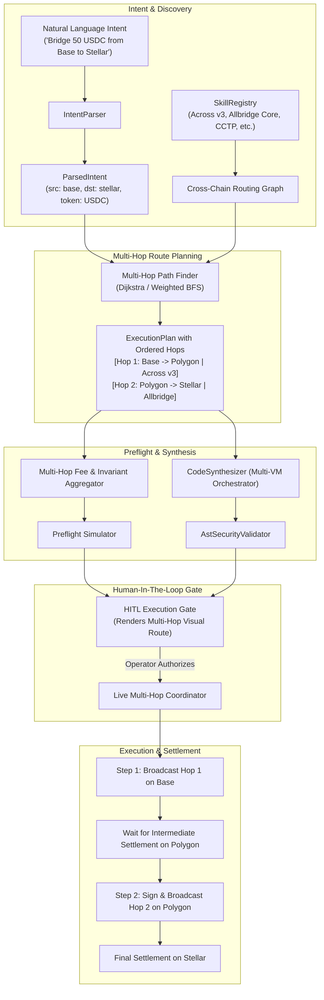

# Technical Specification: Multi-Hop Cross-Chain Routing & Execution Engine

## 1. Executive Summary

Omnibridge 2.0 currently supports single-bridge direct routes (e.g., Base ➔ Arbitrum via Across Protocol v3). When an intent specifies networks that share no direct bridge (e.g., **Base (EVM) ➔ Stellar (WASM/Soroban)** or **Polygon ➔ XRPL**), the engine fails with `No installed bridge skill supports route`.

This technical document specifies the end-to-end architecture, graph-based routing algorithms, state machines, and multi-VM execution flow required to support **automatic multi-hop bridging**.

---

## 2. Architecture & System Flow



---

## 3. Core Component Designs

### 3.1. Routing Graph Representation (`SkillRegistry`)

Currently, `SkillRegistry` statically builds pairwise direct recipes (`src-to-dst-token`). To support multi-hop, we model the cross-chain ecosystem as a **Directed Multigraph**:

* **Nodes**: Network + VM identifiers (e.g. `base:evm`, `polygon:evm`, `stellar:stellar`).
* **Edges**: Supported cross-chain bridges for a specific asset:
  ```typescript
  export interface GraphEdge {
    protocol: string;          // e.g. 'across-v3', 'allbridge-core'
    sourceChain: string;       // e.g. 'base'
    targetChain: string;       // e.g. 'polygon'
    tokenSymbol: string;       // e.g. 'USDC'
    estimatedSettlementSec: number;
    feeRatePercent: number;    // e.g. 0.0025 (0.25%)
    baseGasFeeUsd: number;     // e.g. 0.005 USD
  }
  ```

#### Pathfinding Algorithm: Shortest/Cheapest Weighted BFS
* **Constraints**:
  - Maximum allowable hops: Default `2` (max `3` for complex routes).
  - Minimum guaranteed output constraint: Total compounding fee $\prod (1 - fee_i) \ge (1 - maxSlippage)$.
  - Liquidity/Asset compatibility: Token must be swappable or bridgeable across each node.

```typescript
export interface HopDefinition {
  hopIndex: number;
  protocol: string;
  sourceChain: string;
  targetChain: string;
  inputToken: string;
  outputToken: string;
  intermediateRecipient?: string; // Intermediary wallet address on hop chain
  estimatedSettlementSec: number;
  feeUsd: number;
}
```

---

### 3.2. Intermediate Wallet State & Key Derivation

In a multi-hop transfer across distinct VMs:
* **Hop 1:** `Base (EVM)` ➔ `Polygon (EVM)`
* **Hop 2:** `Polygon (EVM)` ➔ `Stellar`

#### Key Requirement:
1. **Hop 1 Recipient** cannot be the final destination address (Stellar StrKey `GAY...` is invalid on Polygon).
2. **Intermediate Recipient:** The engine must automatically supply the operator's intermediate address for Polygon (derived from the EVM `PRIVATE_KEY`).
3. **Hop 2 Sender:** The intermediate EVM address initiates the bridge transaction to the final Stellar StrKey.

```typescript
export class MultiHopAddressResolver {
  public static resolveIntermediateRecipient(
    hop: HopDefinition,
    finalTargetAddress: string,
    signerAccounts: Record<string, string> // vmType -> address
  ): string {
    const isFinalHop = hop.isFinal;
    if (isFinalHop) {
      return finalTargetAddress;
    }
    // Return operator's intermediate address for this hop chain's VM
    const hopChainVm = hop.targetChainMetadata.vmType;
    const intermediateAddress = signerAccounts[hopChainVm];
    if (!intermediateAddress) {
      throw new Error(`Cannot execute multi-hop route: No private key/address available for intermediate VM (${hopChainVm}) on ${hop.targetChain}`);
    }
    return intermediateAddress;
  }
}
```

---

### 3.3. Execution Plan Schema Extension

Update `ExecutionPlan` in [`src/core/agent/route-planner.ts`](file:///Users/afolabi/projects/omnibridge2.0/src/core/agent/route-planner.ts) to support structured multi-hop manifests:

```typescript
export interface MultiHopExecutionPlan extends ExecutionPlan {
  isMultiHop: boolean;
  hopCount: number;
  hops: HopDefinition[];
  intermediateSettlementTimeSec: number;
  totalCompoundedFeeUsd: number;
  intermediateTokens: {
    chain: string;
    tokenSymbol: string;
    expectedBalance: string;
  }[];
}
```

---

### 3.4. Multi-Hop Code Synthesis (`CodeSynthesizer`)

The synthesized ephemeral script (`.omnibridge/transient/run-*.ts`) must handle sequential execution and polling between hops:

```typescript
// Sample Synthesized Multi-Hop Orchestration Script
import { createPublicClient, createWalletClient, http } from 'viem';
import { Horizon } from '@stellar/stellar-sdk';

export async function executeMultiHop() {
  console.log('[HOP 1/2] Initiating Across v3 deposit: Base -> Polygon...');
  const tx1 = await executeAcrossDeposit({ ... });
  console.log(`[HOP 1/2] Broadcasted: ${tx1}. Waiting for settlement on Polygon...`);
  
  // Step 2: Poll settlement on intermediate chain
  await waitForIntermediateBalance({
    chain: 'polygon',
    token: '0x3c499c542cEF5E3811e1192ce70d8cC03d5c3359',
    expectedAmount: '4.9875',
    timeoutSec: 180,
  });

  console.log('[HOP 2/2] Initiating Hop 2: Polygon -> Stellar...');
  const tx2 = await executeStellarBridge({ ... });
  console.log(`[HOP 2/2] Bridge confirmed: ${tx2}`);
}
```

---

### 3.5. Human-In-The-Loop Gate Visualization

Update [`src/adapters/hitl/cli-hitl.ts`](file:///Users/afolabi/projects/omnibridge2.0/src/adapters/hitl/cli-hitl.ts) to render multi-hop visual ASCII pipelines:

```text
╭──────────────────────────────────────────────────────────────────────────────╮
│                                                                              │
│   OMNIBRIDGE JIT EXECUTION GATE (MULTI-HOP ROUTE)                            │
│                                                                              │
│   Intent:           "Bridge 50 USDC from base to stellar" [LLM: gpt-4o]      │
│   Multi-Hop Route:  base ──[ across-v3 ]──> polygon ──[ allbridge ]──> stellar
│   Hops:             2 Hops (1 Intermediate Settlement)                       │
│   Safety Score:     94/100 (LOW RISK)                                        │
│                                                                              │
│   ────────────────────────────────────────────────────────────────────       │
│   MULTI-HOP TRANSFER BREAKDOWN                                               │
│   ────────────────────────────────────────────────────────────────────       │
│   [HOP 1] Base -> Polygon PoS                                                │
│     Protocol:       across-v3                                                │
│     Input:          50.00 USDC                                               │
│     Output:         49.8750 USDC (Polygon Intermediate)                      │
│     Intermediary:   0xa397ef3874c89b3d2647d51ec7e64ea1a3f36628 (Operator)   │
│     Est. Time:      ~45s                                                     │
│                                                                              │
│   [HOP 2] Polygon PoS -> Stellar                                             │
│     Protocol:       allbridge-core                                           │
│     Input:          49.8750 USDC                                             │
│     Output:         49.6256 USDC (Final Recipient)                           │
│     Destination:    GAYST7Q6N4YQZ54L76A4L5PGBKHK6T3M5Z3Y7C2M9K2L1P0          │
│     Est. Time:      ~90s                                                     │
│                                                                              │
│   ────────────────────────────────────────────────────────────────────       │
│   COMBINED INVARIANTS                                                        │
│   ────────────────────────────────────────────────────────────────────       │
│   Total Fees:       $0.3744 USD (Across: $0.1250 | Allbridge: $0.2494)       │
│   Min Guaranteed:   49.3774 USDC (0.5% Global Max Slippage)                  │
│   Total Est. Time:  ~135 seconds                                             │
│                                                                              │
╰──────────────────────────────────────────────────────────────────────────────╯
```

---

## 4. Implementation Phasing & Work Breakdown

| Phase | Component | Key Deliverables |
| :--- | :--- | :--- |
| **Phase 1** | **Graph Router** | 1. Implement `RoutingGraph` in `src/core/agent/routing-graph.ts`.<br>2. Add Dijkstra/BFS pathfinding for $N \le 3$ hops.<br>3. Unit tests with simulated 2-hop topologies. |
| **Phase 2** | **Skill Catalog Expansion** | 1. Add sample/real bridge skill connecting EVM to non-EVM (e.g. `skills/allbridge-core` or `skills/cctp`).<br>2. Register Stellar / XRPL token metadata in skill schema. |
| **Phase 3** | **Multi-Hop Executor** | 1. Implement `MultiHopCoordinator` in `src/core/execution/multi-hop-coordinator.ts`.<br>2. Add intermediate balance polling and timeout safety triggers.<br>3. Support multi-VM signers (`EVM_PRIVATE_KEY`, `STELLAR_SECRET_KEY`). |
| **Phase 4** | **JIT Synthesizer & HITL** | 1. Synthesize multi-step sequential TypeScript scripts.<br>2. Update CLI HITL card to render multi-hop pipelines.<br>3. Add dry-run simulation for chained balance assertions. |

---

## 5. Security & Failure Recovery Invariants

1. **Intermediate Stall Protection**: If Hop 1 completes on Polygon but Hop 2 fails (e.g. gas spike or bridge pause), funds reside safely in the operator's intermediate Polygon wallet. The coordinator writes a persistent recovery state to `.omnibridge/recovery/` with transaction hashes.
2. **Atomic Slippage Check**: If Hop 1 delivers less than expected due to unexpected slippage, Hop 2 must recalculate invariant bounds and abort if the minimum guaranteed output to the final recipient would be breached.
3. **VM Nonce Management**: Each hop executes with isolated nonce tracking per chain to avoid replacement race conditions.
