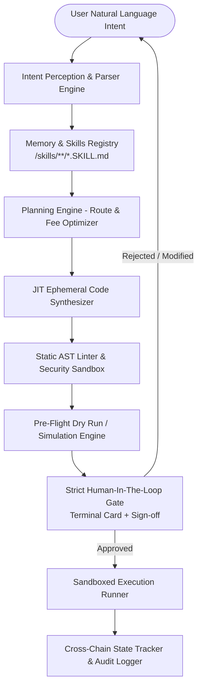

# Product Requirement Document (PRD)
## Just-In-Time (JIT) Blockchain Omnibridge Engine & CLI

**Version:** 1.0.0  
**Status:** Approved for Implementation  
**Runtime:** Node.js (v20+ LTS) / TypeScript (Strict Mode)  
**Architecture:** Agentic Engineering (Perception-Memory-Action with Ephemeral JIT Code Synthesis & Strict HITL Gate)

---

## 1. Executive Summary & Vision

### 1.1 Problem Statement
Cross-chain decentralized finance and asset transfers are plagued by combinatorial complexity. With heterogeneous virtual machines (EVMs like Polygon/Base/Arbitrum, Stellar Soroban & Horizon, XRP Ledger XRPL, Solana, Cosmos), differing transaction models (account-based vs. UTXO vs. trustlines/memos), and fragmented bridge protocols (Across, LayerZero, Circle CCTP, Wormhole, Stargate, Hyperlane), maintaining static software integrations requires $O(2^n)$ static interaction pathways. Static SDKs rot quickly as bridge contracts upgrade, APIs deprecate, or fee dynamics shift.

### 1.2 The JIT Agentic Solution
Drawing on the **Agentic Engineering** paradigm (*"The End of Software Engineering: How AI Agents Are Fundamentally Restructuring the Software Paradigm"*, Cao 2026), this system eliminates the static integration software artifact as an intermediary. 
Instead of hardcoding hundreds of bridge permutations:
1. **Procedural Protocol Skills (`SKILL.md`)**: Bridge and blockchain knowledge is decentralized into human-and-machine-readable modular protocol skills.
2. **Intent Parsing & Route Decomposition**: The reasoning core decomposes natural language intent (e.g., *"Move 500 USDC from Polygon to my Stellar wallet, low slippage"*) into verifiable cross-chain action sequences.
3. **Just-In-Time (JIT) Ephemeral Code Generation**: The engine dynamically compiles a single-use, strictly typed, executable TypeScript execution script tailored precisely to that exact route and context.
4. **Strict Human-in-the-Loop (HITL) Execution Gate**: The agent operates in the driver's seat, but the human retains complete supervisory authority. No transaction or private key action is ever executed without automated dry-run simulation, static security analysis, risk-boundary validation, and interactive cryptographic human sign-off.

---

## 2. Core Architectural Model

Following the formal agent model $A = (M, \mathcal{T}, \mathcal{M}, \Pi)$:



### 2.1 Formal Subsystem Mapping

| Mathematical Component | Architectural Implementation | Description |
| :--- | :--- | :--- |
| **Reasoning Core ($M$)** | **100% Model-Agnostic LLM Provider Interface** | Unified `ILanguageModel` abstraction supporting Anthropic, OpenAI, Google Gemini, and any OpenAI-compatible endpoint (Ollama, vLLM, OpenRouter, DeepSeek, Groq) with zero vendor lock-in. |
| **Tools ($\mathcal{T}$)** | Protocol Skills & Node Adapters | Chain RPC clients (Viem for EVM, Stellar SDK, XRPL Client), contract encoders, quote aggregators, token list resolvers. |
| **Memory ($\mathcal{M}$)** | Skill Registry & Context Cache | Modular `skills/<protocol>/SKILL.md` parser, local vector/keyword registry, cached gas/fee indices, address book. |
| **Planner ($\Pi$)** | Intent Decomposer & Route Planner | Multi-hop route solver that creates a deterministic `ExecutionPlan` with clear invariant checks. |

### 2.2 Model-Agnostic Reasoning Engine Architecture

The reasoning engine $M$ is strictly decoupled from any proprietary model API using a unified abstraction:

```typescript
export interface ModelMessage {
  role: 'system' | 'user' | 'assistant';
  content: string;
}

export interface StructuredGenerationOptions<T> {
  messages: ModelMessage[];
  schema: z.ZodType<T>;
  schemaName: string;
  temperature?: number;
}

export interface ILanguageModel {
  readonly providerName: string;
  readonly modelId: string;

  // Enforces structured output validated against Zod schema
  generateStructured<T>(options: StructuredGenerationOptions<T>): Promise<T>;

  // Generates clean TypeScript code with no conversational preamble
  generateCode(options: { messages: ModelMessage[]; temperature?: number }): Promise<string>;
}
```

#### Supported Providers Out-of-the-Box:
1. **OpenAI Compatible Endpoint Adapter**: Connects to OpenAI (`gpt-4o`, `o3-mini`), OpenRouter, DeepSeek (`deepseek-coder`, `deepseek-chat`), Groq, or local inference (Ollama, vLLM, LM Studio) via standard `baseURL` + `apiKey`.
2. **Anthropic Adapter**: Claude 3.5 Sonnet / Haiku / Opus.
3. **Google Gemini Adapter**: Gemini 2.0 Flash / 1.5 Pro / Flash.
4. **Offline / Mock Provider**: Deterministic rule-based synthesizer for offline CI/CD, sandboxed test harnesses, and air-gapped environments without external LLM dependencies.

---

## 3. Modular Skill/Reference Architecture (`SKILL.md`)

Each blockchain network and bridge protocol is defined as an independent, composable module stored in `./skills/<domain>/<name>/SKILL.md`.

### 3.1 Skill Directory Structure
```
skills/
├── chains/
│   ├── polygon/
│   │   ├── SKILL.md
│   │   └── references/
│   ├── base/
│   │   ├── SKILL.md
│   │   └── references/
│   ├── arbitrum/
│   │   ├── SKILL.md
│   │   └── references/
│   ├── stellar/
│   │   ├── SKILL.md
│   │   └── references/
│   └── xrpl/
│       ├── SKILL.md
│       └── references/
├── bridges/
│   ├── across-v3/
│   │   ├── SKILL.md
│   │   └── references/
│   ├── circle-cctp/
│   │   ├── SKILL.md
│   │   └── references/
│   ├── layerzero-v2/
│   │   ├── SKILL.md
│   │   └── references/
│   ├── stargate/
│   │   ├── SKILL.md
│   │   └── references/
│   └── allbridge-core/
│       ├── SKILL.md
│       └── references/
└── templates/
    └── base-execution-script.ts.template
```

### 3.2 Canonical `SKILL.md` Specification
Every `SKILL.md` contains strict YAML frontmatter and structured markdown instructions:
```markdown
---
name: circle-cctp
version: 1.0.0
category: bridge
supportedChains:
  - polygon
  - base
  - arbitrum
supportedTokens:
  - USDC
  - EURC
capabilities:
  - native-burn-and-mint
  - zero-slippage
requirements:
  nodePackages:
    - viem
    - @noble/hashes
  environmentVariables:
    - POLYGON_RPC_URL
    - BASE_RPC_URL
    - ARBITRUM_RPC_URL
---

# Circle Cross-Chain Transfer Protocol (CCTP) Skill

## Overview
Circle CCTP burns native USDC on the source chain and attests it via Circle Attestation Service, minting 1:1 native USDC on the destination chain without slippage.

## Contract Addresses & Domain Identifiers
| Chain | Domain ID | TokenMessenger Contract | MessageTransmitter Contract |
|-------|-----------|--------------------------|------------------------------|
| Polygon (PoS) | 7 | 0x9daF83... | 0x... |
| Base | 6 | 0x1682Eb... | 0x... |
| Arbitrum One | 3 | 0x19330d... | 0x... |

## Execution Sequence
1. Approve `TokenMessenger` to spend amount of USDC.
2. Call `depositForBurn(amount, destinationDomain, mintRecipient, burnToken)`.
3. Fetch signed attestation from `https://iris-api.circle.com/attestations/${messageHash}`.
4. On destination chain, call `receiveMessage(message, attestation)`.

## Error Handling & Invariants
- `mintRecipient` must be bytes32 padded (`padHex(address, { size: 32 })`).
- Destination domain must match target chain ID.
```

---

## 4. System Workflow & Intent Lifecycle

### Step 1: Natural Language Intent Parsing & Entity Extraction
- User inputs natural language: e.g. `"Bridge 250 USDC from Polygon to my Stellar wallet GAY... with maximum 0.5% slippage"`.
- Engine parses:
  - `sourceChain`: `polygon` (EVM, ChainID: 137)
  - `destinationChain`: `stellar` (Non-EVM, Public Horizon)
  - `sourceToken`: `USDC` (0x3c499c542cEF5E3811e1192ce70d8cC03d5c3359)
  - `destinationToken`: `USDC` (Stellar Asset: USDC:GA5ZSEJY...)
  - `amount`: `250.0`
  - `destinationAddress`: `GAY...`
  - `constraints`: `{ maxSlippageBps: 50, speedPriority: "balanced" }`
  - `memoRequired`: Stellar memo requirement check (detects if destination is exchange address or requires memo tag).

### Step 2: Route Discovery & Skill Resolution
- The Skill Registry indexes skills matching `sourceChain`, `destinationChain`, and `token`.
- If a direct native bridge exists (e.g. Allbridge Core for Polygon to Stellar or CCTP for Polygon to Base), it selects the optimal path.
- If multi-hop is required (e.g. Polygon USDC $\rightarrow$ Arbitrum USDC via CCTP, then swap to ARB via Uniswap v3), the planner composes multi-skill pipelines.

### Step 3: Just-In-Time (JIT) Code Generation
- The Synthesizer pulls code generation guidelines and contract ABIs from the resolved `SKILL.md` files.
- Generates a standalone, strictly-typed Node.js TypeScript script in an ephemeral directory (`.omnibridge/transient/run-<timestamp>-<hash>.ts`).
- The script:
  - Uses typed SDKs (`viem`, `@stellar/stellar-sdk`, `xrpl`).
  - Reads keys only from the local secure session runner (never hardcoded in script text).
  - Implements step-by-step transaction assertions and gas limit guards.

### Step 4: Multi-Layer Static Analysis & Security Sandbox
Before any interaction with live nodes:
1. **Abstract Syntax Tree (AST) Analysis**:
   - Forbids network access to unauthorized external endpoints (allows only configured RPCs and official attestation APIs).
   - Forbids reading sensitive local files (`.env`, `id_rsa`, `.ssh`, browser cookies).
   - Validates that private keys are consumed strictly through transient signing handlers.
2. **Deterministic Invariant Validation**:
   - `amountOutMin >= amountIn * (1 - maxSlippage)`.
   - `destinationAddress` matches checksum (EIP-55 for EVM, StrKey for Stellar, Base58Check for XRPL).
   - Non-zero balance verification on source address.

### Step 5: Pre-Flight Dry Run & Simulation
- **EVM Chains**: Simulates transactions via `eth_call` or Tenderly/Anvil fork simulation to inspect event logs, state changes, and revert reasons.
- **Stellar**: Runs transactions against Horizon `/fee_stats` and simulates via Soroban `simulateTransaction`.
- **XRPL**: Validates account sequence and fee drops with `account_info`.
- Computes exact expected fees: Source Gas Fee + Bridge Protocol Fee + Destination Claim/Relayer Fee.

### Step 6: Strict Human-In-The-Loop (HITL) Gate
The CLI prints an interactive high-contrast **Audit Card**:
```text
================================================================================
                       OMNIBRIDGE JIT EXECUTION GATE
================================================================================
Intent:           "Bridge 250 USDC from Polygon to Stellar"
Selected Route:   Polygon (PoS) ──[ Allbridge Core ]──> Stellar Network
Safety Score:     98/100 (LOW RISK)

--------------------------------------------------------------------------------
TRANSFER DETAILS
--------------------------------------------------------------------------------
Source Chain:     Polygon (EVM Chain ID 137)
Source Wallet:    0x71C...392A (Balance: 1,420.50 USDC, 14.2 POL)
Source Asset:     USDC (0x3c499c542cEF5E3811e1192ce70d8cC03d5c3359)
Transfer Amount:  250.00 USDC

Bridge Protocol:  Allbridge Core v2 (Pool: 0x82... Contract: 0xba...)
Estimated Bridge Fee: 0.65 USDC (0.26%)
Estimated Gas:    0.008 POL (~$0.003 USD)

Target Chain:     Stellar Mainnet
Target Wallet:    GAYST7Q6N4YQZ54L76A4L5PGBKHK6T3M5Z3Y7C2M9K2L1P0 (Active Trustline)
Target Asset:     USDC:GA5ZSEJYB37JRC5AVCIA5MOP4RHTM335X2KGX3IHOJAPP5RE34K4KZVN
Estimated Output: 249.35 USDC (Min Guaranteed: 248.75 USDC)
Slippage Bound:   0.50% (Max allowable deviation: 1.25 USDC)

--------------------------------------------------------------------------------
INSPECTION & CODE AUDIT
--------------------------------------------------------------------------------
Ephemeral Script: .omnibridge/transient/run-1728919000-poly-xlm.ts
AST Safety Linter: PASSED (Zero unauthorized endpoints, typed Viem+Stellar bindings)
Simulation Result: SUCCESS (Expected gas used: 84,210 units)

Action Steps:
  [Step 1] Approve 250.0 USDC to Allbridge Router (0xba...) on Polygon
  [Step 2] Call sendPayload(amount, destChainId, recipient) on Polygon
  [Step 3] Monitor relayer attestation & target credit on Stellar Horizon

Type [y/N] to proceed, [v] to view generated TypeScript code, [a] to abort: 
```

- If the user selects `v`, the syntax-highlighted generated code is printed or opened in the pager.
- For high-value transactions (e.g. > $1,000 USD equivalent), the system prompts for explicit confirmation phrase typing: `CONFIRM 250 USDC TO STELLAR`.

### Step 7: Ephemeral Execution & Real-Time Telemetry
- Script executes within a controlled child process.
- Streams live progress: Approval $\rightarrow$ Lock/Deposit $\rightarrow$ Cross-Chain Message Relaying $\rightarrow$ Destination Mint/Claim $\rightarrow$ Final Balance Verification.
- Once complete, transient code is moved to `.omnibridge/archive/` with full transaction receipts and execution hash for reproducibility, leaving no lingering execution processes.

---

## 5. Security & Safety Architecture

### 5.1 Key Management & Zero-Exfiltration Guarantee
- **No plaintext private keys in LLM prompts**: The LLM *never* sees private keys, seed phrases, or keystore passwords. The LLM only generates code referencing a standard injected provider or environment variable name (e.g. `process.env.OMNIBRIDGE_SIGNER_KEY`).
- **Encrypted Local Keystore**: Keys can be stored in an AES-256-GCM encrypted keystore file (`.omnibridge/keystore.enc`) protected by password/passphrase or OS Keychain.
- **Hardware Wallet / Remote Signer Ready**: Architecture supports Ledger / Web3 signer abstractions where signatures occur outside the Node.js process.

### 5.2 Slippage & Sandwich Attack Defenses
- Hard limits on acceptable slippage (default max 1.0%, customizable).
- JIT deadline checks: Any EVM transaction generated includes `block.timestamp + 300` (5-minute maximum TTL) to avoid pending transactions getting executed at disadvantageous rates later.

### 5.3 Address Integrity & Cross-VM Validation
- **EVM**: EIP-55 checksum validation.
- **Stellar**: `StrKey.isValidEd25519PublicKey(dest)` + Account Trustline inspection on Horizon. If trustline for USDC is missing, the engine alerts the user before burning funds.
- **XRPL**: Account existence check and Destination Tag enforcement.

---

## 6. Protocols & Chains Included in Phase 1

### 6.1 Blockchain Networks
1. **Polygon (PoS)**: EVM, fast settlement, low gas.
2. **Base**: Optimistic L2, native Coinbase ecosystem & CCTP.
3. **Arbitrum One**: Nitro L2, deep liquidity.
4. **Stellar**: Non-EVM, Soroban smart contracts & classic Horizon asset channels.
5. **XRP Ledger (XRPL)**: Non-EVM, trustlines, payment channels, and Interledger/Axelar bridges.

### 6.2 Bridge Protocols
1. **Circle CCTP**: Native burning/minting for USDC between EVM chains (Polygon, Base, Arbitrum).
2. **Across Protocol v3**: Intent-based fast relay bridge across EVMs.
3. **Allbridge Core / Allbridge Classic**: EVM to Non-EVM (Stellar, Solana) cross-chain pools.
4. **XRPL / EVM Bridge Connectors**: XRP to Arbitrum / EVM via Ripple Sidechains / Axelar wrapped XRP.

---

## 7. CLI Command Surface & User Experience

The CLI tool `omnibridge` provides an intuitive yet powerful developer interface:

```bash
# 1. Interactive Natural Language Command (Default)
omnibridge "Bridge 100 USDC from Base to Arbitrum"

# 2. Cross-VM Transfer (EVM to Stellar)
omnibridge "Send 50 USDC from Polygon to GAYST7Q6N4YQZ54L76A4L5PGBKHK6T3M5Z3Y7C2M9K2L1P0 on Stellar"

# 3. Dry-Run Only (Generate code & simulate without execution)
omnibridge "Send 10 XRP from XRPL to Arbitrum" --dry-run

# 4. Interactive REPL Mode
omnibridge repl

# 5. Modular Skill Management
omnibridge skills list
omnibridge skills inspect circle-cctp
omnibridge skills test polygon

# 6. Wallet & Keystore Management
omnibridge wallet import
omnibridge wallet list
omnibridge wallet balance --all
```

---

## 8. Technical Architecture & File Organization

```
omnibridge2.0/
├── package.json
├── tsconfig.json
├── bin/
│   └── omnibridge.ts                # CLI entry point (shebang #!/usr/bin/env node)
├── src/
│   ├── index.ts                     # Main library export
│   ├── cli/
│   │   ├── commands/
│   │   │   ├── bridge.command.ts    # Main natural language intent runner
│   │   │   ├── skills.command.ts    # Skill inspect & validate commands
│   │   │   ├── wallet.command.ts    # Secure key / wallet commands
│   │   │   └── repl.command.ts      # Interactive shell
│   │   └── ui/
│   │       ├── audit-card.ts        # Beautiful high-contrast HITL Audit Card
│   │       └── progress-bar.ts      # Step-by-step progress spinner
│   ├── core/
│   │   ├── agent/
│   │   │   ├── omni-agent.ts        # Agent orchestrator (M, T, M, Pi)
│   │   │   ├── intent-parser.ts     # NLP intent extractor with schema validation
│   │   │   └── route-planner.ts     # Multi-chain pathway planner
│   │   ├── skills/
│   │   │   ├── skill-registry.ts    # Loads & parses SKILL.md modules
│   │   │   ├── skill-matcher.ts     # Selects best skills for given intent
│   │   │   └── skill.types.ts       # Type definitions for Skills
│   │   ├── synthesizer/
│   │   │   ├── code-synthesizer.ts  # JIT code generation engine
│   │   │   ├── ast-validator.ts     # Static security linter (banned APIs, unsafe imports)
│   │   │   └── sandbox-runner.ts    # Child process sandbox execution with timeout
│   │   ├── simulation/
│   │   │   ├── evm-simulator.ts     # Viem eth_call & state simulation
│   │   │   ├── stellar-simulator.ts # Horizon & Soroban simulation
│   │   │   └── xrpl-simulator.ts    # XRPL transaction simulation
│   │   └── security/
│   │       ├── hitl-gate.ts         # Strict Human-In-The-Loop verification logic
│   │       ├── keystore.ts          # AES-256-GCM local encrypted key storage
│   │       └── address-checker.ts   # Multi-VM address & checksum verifier
│   └── utils/
│       ├── config.ts                # Environment & RPC provider configuration
│       ├── logger.ts                # Winston / chalk color logger
│       └── formatters.ts            # Currency, token, and hash formatters
├── skills/                          # Modular SKILL.md registry
│   ├── chains/
│   └── bridges/
└── test/
    ├── intent-parser.test.ts
    ├── skill-registry.test.ts
    ├── ast-validator.test.ts
    └── hitl-gate.test.ts
```

---

## 9. Implementation Milestones

### Milestone 1: Foundations & Skill Registry Engine
- TypeScript project setup with strict typing, ES modules, and build scripts.
- YAML frontmatter parser and markdown extractor for `SKILL.md`.
- Implementation of initial core skills: `polygon`, `base`, `arbitrum`, `stellar`, `xrpl`, `circle-cctp`, `across-v3`, `allbridge-core`.

### Milestone 2: Intent Parsing & Route Decomposition
- Natural Language Intent Parser with Zod schema validation (supports direct EVM-to-EVM and cross-VM EVM-to-Stellar / EVM-to-XRPL).
- Skill Matching Engine that binds intent entities to appropriate chain and bridge skills.
- Route Planner calculating fee estimates, slippage constraints, and step sequence.

### Milestone 3: JIT Ephemeral Code Synthesizer & AST Security Sandbox
- Dynamic code generation templates using `viem`, `@stellar/stellar-sdk`, and `xrpl`.
- AST Static Security Validator using TypeScript Compiler API / acorn to ban dangerous modules (`fs.unlink`, arbitrary child processes, unauthorized network fetch).
- Secure execution runner executing the ephemeral script in an isolated sub-process with timeouts and structured event emission.

### Milestone 4: Simulation & Strict HITL Gate
- Multi-VM pre-flight simulation (EVM gas simulation, Stellar trustline checks, XRPL destination tag checks).
- Rich CLI Audit Card rendering (intent summary, route, fees, slippage, warnings, raw code inspector).
- Interactive user confirmation gate (abort, view code, simulate, confirm).

### Milestone 5: Testing, E2E CLI & Documentation
- Comprehensive unit test suite covering intent parsing, security AST validation, skill discovery, and HITL gate.
- CLI binary packaging and configuration guide.
