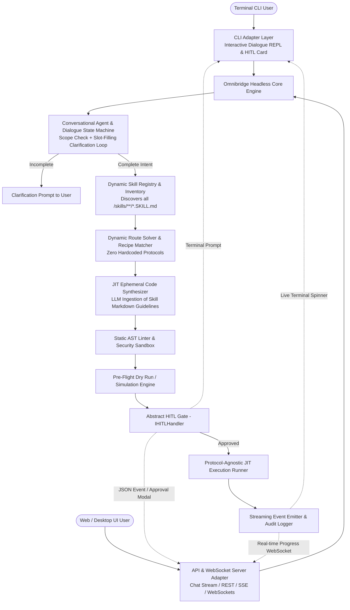
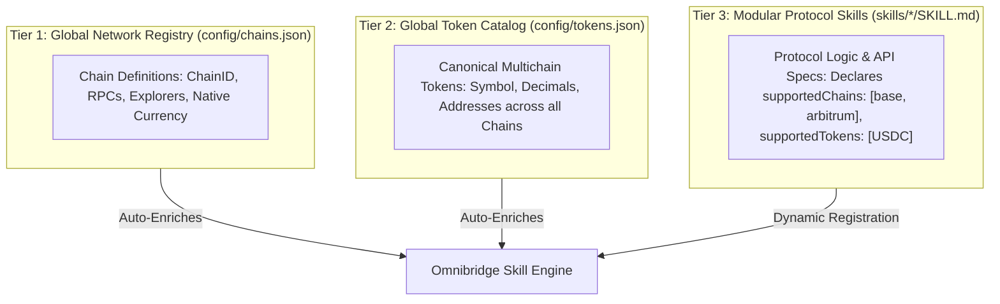

# Product Requirement Document (PRD)
## Just-In-Time (JIT) Blockchain Omnibridge Engine (Headless Core, Conversational Agent & UI-Ready)

**Version:** 1.2.0  
**Status:** Approved for Implementation  
**Runtime:** Node.js (v20+ LTS) / TypeScript (Strict Mode)  
**Architecture:** Decoupled Headless Engine (Perception-Memory-Action) with Multi-Turn Conversational Clarification, Dynamic Skill Ingestion, Ephemeral JIT Code Synthesis, and Pluggable HITL Interfaces (CLI & Web/Desktop UI)

---

```
The main Goal of omninbridge is not to handle user intent, but to redunce developer time to integrate protocols, and provide a bridge that can support any protocol within dew, instead writing hardcoded code, we write protocol specific skills, this mean user interface of today still can still remain the same, the main difference will be the engine behind the scene, the old hardcoded code now replaced my llm routing using specified skills writing in plain human readable language, with the help of new agentic development method, we can support any protocol with minimum effort, as long as it provide good documentation and SDK, we can support it with minimum effort.
```

## 1. Executive Summary & Vision

### 1.1 Problem Statement
Cross-chain decentralized finance and asset transfers are plagued by combinatorial complexity. With heterogeneous virtual machines (EVMs like Polygon/Base/Arbitrum, Stellar Soroban & Horizon, XRP Ledger XRPL, Solana, Cosmos), differing transaction models (account-based vs. UTXO vs. trustlines/memos), and fragmented bridge protocols (Across, LayerZero, Circle CCTP, Wormhole, Stargate, LiFi, Hyperlane), maintaining static software integrations requires O(n^2) pairwise pathways and up to O(2^n) multi-hop compositional states. Static SDKs rot quickly as bridge contracts upgrade, APIs deprecate, or fee dynamics shift. Furthermore, traditional CLIs and forms fail when users provide ambiguous or incomplete requests, leading to hard crashes or unsafe default assumptions.

### 1.2 The JIT Agentic Solution & Core Architectural Invariants
Drawing on the **Agentic Engineering** paradigm (*"The End of Software Engineering: How AI Agents Are Fundamentally Restructuring the Software Paradigm"*, Cao 2026), this system eliminates the static integration software artifact as an intermediary and replaces rigid code paths with dynamic model-driven reasoning:

1. **Multi-Turn Conversational Intent & Scope Evaluation**: 
   - A user interacts conversationally with the model.
   - The model evaluates whether the user's request falls within the scope of cross-chain bridging and asset transfer. If out of scope, it explains its capabilities and gently guides the user back.
   - If details are incomplete (missing source/destination chain, token, transfer amount, recipient address, or memo), the model iteratively asks clarifying questions until all necessary transaction parameters are resolved.
2. **Dynamic Skill-Driven Execution (Zero-Hardcoding Invariant)**:
   - **MANDATORY RULE:** **No blockchain network, bridge protocol, DEX, or route pathway may be hardcoded into the core engine source code (`src/`), not even as an `if/else` or `switch` branch.**
   - All blockchain capabilities, API endpoints, quote formats, and execution rules reside exclusively in modular protocol skill packages (`skills/<protocol>/SKILL.md`).
   - The core engine is a universal, protocol-agnostic orchestration runtime.
3. **Skill Discovery & Dynamic Route Resolution**:
   - Once all transaction parameters are gathered, the reasoning core inspects its installed skill registry (`skills/**/*.SKILL.md`).
   - The model dynamically evaluates which installed skill(s) satisfy the route and decides how the transaction should be handled without hardcoded protocol dispatchers.
4. **Just-In-Time (JIT) Ephemeral Code Generation**:
   - The engine compiles a single-use, strictly typed, executable TypeScript execution script tailored precisely to that exact route and context, directly drawing from the procedural rules in the selected skill's `SKILL.md`.
5. **Decoupled Headless Core (CLI & Web UI Dual Support)**:
   - The core engine is 100% headless and event-driven. It outputs structured JSON payloads (`AuditPayload`, `SimulationResult`, `ExecutionEvent`) consumed equally by a terminal CLI and a modern web/desktop UI.
6. **Pluggable Human-in-the-Loop (HITL) Gate**:
   - Complete supervisory authority via an abstract `IHITLHandler` interface—supporting interactive terminal confirmation in CLI mode, and WebSocket / REST approval modal in Web UI mode.

---

## 2. Core Architectural Model
 
Following the formal agent model A = (M, T, Memory, Pi), the core engine is decoupled from the user-facing presentation layer:



### 2.1 Formal Subsystem Mapping

| Mathematical Component | Architectural Implementation | Description |
| :--- | :--- | :--- |
| **Reasoning Core (M)** | **Conversational Dialogue & Intent Engine** | Evaluates user scope, handles multi-turn clarification questions, and extracts complete structured bridge intents using unified `ILanguageModel`. |
| **Tools (T)** | Modular Protocol Skills (`SKILL.md`) | Discovered dynamically at runtime. Contains API endpoints, SDK patterns, chain configs, and transaction synthesis rules. Core source has zero protocol branches. |
| **Memory** | Dynamic Skill Registry & Conversation State | Tracks multi-turn dialogue slots, active/installed skills inventory, network RPC indices, and address checksum rules. |
| **Planner (Pi)** | Dynamic Route Resolver & JIT Code Synthesizer | Evaluates matching skills against the resolved intent, constructs execution plans, and synthesizes single-use execution scripts strictly from skill knowledge. |

### 2.2 Model-Agnostic Reasoning Engine Architecture

The reasoning engine (M) is strictly decoupled from any proprietary model API using a unified abstraction:

```typescript
export interface ModelMessage {
  role: 'system' | 'user' | 'assistant';
  content: string;
}

export interface StructuredGenerationOptions<T> {
  messages: ModelMessage[];
  schema: z.ZodType<T>;
  schemaName: string;
  temperature?: number;
}

export interface ILanguageModel {
  readonly providerName: string;
  readonly modelId: string;

  // Enforces structured output validated against Zod schema
  generateStructured<T>(options: StructuredGenerationOptions<T>): Promise<T>;

  // Generates clean TypeScript code with no conversational preamble
  generateCode(options: { messages: ModelMessage[]; temperature?: number }): Promise<string>;
}
```

#### Supported Providers Out-of-the-Box:
1. **OpenAI Compatible Endpoint Adapter**: Connects to OpenAI (`gpt-4o`, `o3-mini`), OpenRouter, DeepSeek (`deepseek-coder`, `deepseek-chat`), Groq, or local inference (Ollama, vLLM, LM Studio) via standard `baseURL` + `apiKey`.
2. **Anthropic Adapter**: Claude 3.5 Sonnet / Haiku / Opus.
3. **Google Gemini Adapter**: Gemini 2.0 Flash / 1.5 Pro / Flash.
4. **Offline / Mock Provider**: Deterministic rule-based synthesizer for offline CI/CD, sandboxed test harnesses, and air-gapped environments without external LLM dependencies.

---

## 3. Modular Skill/Reference Architecture (`SKILL.md`)

Each blockchain network and bridge protocol is defined **strictly** as an independent, self-contained `SKILL.md` file. No chains or protocols are hardcoded in application logic.

### 3.1 Skill Directory Structure
```
skills/
├── chains/
│   ├── polygon/
│   │   ├── SKILL.md
│   │   └── references/
│   ├── base/
│   │   ├── SKILL.md
│   │   └── references/
│   ├── arbitrum/
│   │   ├── SKILL.md
│   │   └── references/
│   ├── stellar/
│   │   ├── SKILL.md
│   │   └── references/
│   └── xrpl/
│       ├── SKILL.md
│       └── references/
├── bridges/
│   ├── across-v3/
│   │   ├── SKILL.md
│   │   └── references/
│   ├── circle-cctp/
│   │   ├── SKILL.md
│   │   └── references/
│   ├── layerzero-v2/
│   │   ├── SKILL.md
│   │   └── references/
│   ├── stargate/
│   │   ├── SKILL.md
│   │   └── references/
│   └── allbridge-core/
│       ├── SKILL.md
│       └── references/
└── templates/
    └── base-execution-script.ts.template
```

### 3.2 3-Tier Scalable Registry Architecture

To prevent massive redundancy across multiple protocol skills and avoid copy-pasting chain RPCs and multichain contract addresses into every bridge definition, Omnibridge 2.0 adopts a **3-Tier Registry Architecture**:



#### Tier 1: Centralized Network Registry (`config/chains.json`)
Defines canonical network metadata once across the entire repository:
```json
{
  "polygon": {
    "displayName": "Polygon PoS",
    "chainId": 137,
    "vmType": "evm",
    "nativeToken": { "symbol": "POL", "name": "Polygon", "decimals": 18 },
    "defaultRpc": "https://polygon-rpc.com",
    "blockExplorer": "https://polygonscan.com"
  },
  "base": {
    "displayName": "Base",
    "chainId": 8453,
    "vmType": "evm",
    "nativeToken": { "symbol": "ETH", "name": "Ether", "decimals": 18 },
    "defaultRpc": "https://mainnet.base.org",
    "blockExplorer": "https://basescan.org"
  }
}
```

#### Tier 2: Centralized Multichain Token Catalog (`config/tokens.json`)
Defines canonical multichain token addresses and decimals globally:
```json
{
  "USDC": {
    "symbol": "USDC",
    "name": "USD Coin",
    "decimals": 6,
    "addresses": {
      "polygon": "0x3c499c542cEF5E3811e1192ce70d8cC03d5c3359",
      "base": "0x833589fCD6eDb6E08f4c7C32D4f71b54bdA02913",
      "arbitrum": "0xaf88d065e77c8cC2239327C5EDb3A432268e5831",
      "stellar": "GA5ZSEJYB37JRC5AVCIA5MOP4RHTM335X2KGX3IHOJAPP5RE34K4KZVN"
    }
  }
}
```

#### Tier 3: Lightweight Protocol Skills (`skills/<protocol>/SKILL.md`)
Bridge skills declare only the networks and symbols they support; the engine auto-resolves addresses and chain parameters:
```markdown
---
name: across-v3
displayName: "Across Protocol v3 (Swap API)"
type: bridge
version: 3.0.0

# Supported Networks (Resolved from Tier 1)
supportedChains:
  - polygon
  - base
  - arbitrum

# Supported Assets (Resolved from Tier 2)
supportedTokens:
  - USDC

capabilities:
  - swap-api-v3
  - intent-fast-fill
---
```

> [!IMPORTANT]
> **Strict Intersection Enforcement & Single Source of Truth:**
> - **Tier 1 (`config/chains.json`) is the Gatekeeper for Networks:** Only chains explicitly configured in `chains.json` are loaded. Disabling a chain here instantly turns off all routes for that chain across all skills.
> - **Tier 2 (`config/tokens.json`) is the Gatekeeper for Tokens:** A token is only routeable on a chain if a verified contract address is defined. Currently, only **USDC** is active.
> - **Tier 3 (`skills/*/SKILL.md`) is Declarative Protocol Capabilities:** Active routes are strictly computed as $\text{Skill.chains} \cap \text{chains.json}$ and $\text{Skill.tokens} \cap \text{tokens.json}$. Skills cannot create phantom chains or unconfigured token routes.
>
> 📖 For a step-by-step developer guide on adding chains, tokens, and bridge skills, see [docs/ADDING_BRIDGES_CHAINS_TOKENS.md](./ADDING_BRIDGES_CHAINS_TOKENS.md).

### 3.3 Hybrid SkillRegistry: Fast Seed Catalog & Route Recipes (`src/core/skills/skill-registry.ts`)

To ensure **sub-second latency and zero cold-start delay**, the `SkillRegistry` implements a hybrid architecture:

1. **Curated Fast Seed Catalog (`src/core/registry/seed-catalog.ts`)**:
   - Pre-indexes canonical chains, tokens, addresses, decimals, and planned tokens directly from Tier 1 & Tier 2 files into memory.
   - Provides instantaneous (<1ms) address, decimal, and capability resolution without waiting for file scans.
   - Any external or custom `SKILL.md` dropped into `./skills/` seamlessly merges with or augments this seed registry.

2. **Deterministic Route Hints & Multi-Hop Recipes**:
   - Contains explicit, optimal preset route hints for common cross-chain pairs.
   - Tells the agent engine the exact recommended pathway (e.g. `Base -> Arbitrum` should use `Across Protocol v3`).
   - Prevents slow exploratory LLM reasoning loops, ensures 100% route determinism, and slashes execution planning latency from seconds to milliseconds.

```typescript
export interface RouteRecipe {
  id: string;
  sourceChain: string;
  targetChain: string;
  tokenSymbol: string;
  recommendedBridge: string;
  hops: {
    step: number;
    action: 'approve' | 'swap' | 'bridge' | 'claim';
    chain: string;
    protocol: string;
    details: string;
  }[];
  expectedSettlementTimeSec: number;
  notes?: string;
}

export interface SkillRegistryConfig {
  seedChains: ChainMetadata[];
  seedTokens: TokenMetadata[];
  routeRecipes: RouteRecipe[];
}

export interface ProtocolCapabilityEngine {
  loadSkills(): Promise<void>;
  getSupportedChains(): ChainMetadata[];
  getSupportedTokens(chain?: string): TokenMetadata[];
  getAvailableRoutes(sourceChain: string, targetChain: string, tokenSymbol?: string): AvailableRoute[];
  getRecommendedRecipe(sourceChain: string, targetChain: string, tokenSymbol: string): RouteRecipe | null;
  formatCapabilityContextForLLM(): string;
}
```

#### Pre-configured Fast Route Recipes:
- **Polygon -> Stellar (USDC)**: Fast path via `Allbridge Core` (Single-hop lock on Polygon, mint on Stellar).
- **Polygon -> Base (USDC)**: Fast path via `Circle CCTP` (Native burn on Polygon, mint on Base via Circle Attestation).
- **Base -> Arbitrum (USDC/ETH)**: Fast path via `Across Protocol v3` (Intent relay, settles in ~2 seconds).
- **XRPL -> Arbitrum (XRP)**: Fast path via `Axelar / XRPL Gateway` (Lock XRP on XRPL, mint axlXRP on Arbitrum).

#### Subsystem Capabilities:
1. **As LLM Tools & Fast Hints**: Automatically provides the model with up-to-date chains, tokens, and instant route recipes.
2. **As CLI Discovery Commands**:
   - `omnibridge chains` — lists all active & planned chains
   - `omnibridge tokens` — lists all supported tokens across chains
   - `omnibridge routes` — displays the bridge matrix and suggested multi-hop paths

---

## 4. System Workflow & Intent Lifecycle

### Step 1: Conversational Dialogue & Multi-Turn Intent Clarification
Rather than assuming a rigid single-shot command, Omnibridge utilizes a conversational state machine (`DialogueEngine` / `ChatSession`) to interact with the user:

```
[User Message]
       │
       ▼
1. Scope Evaluation Gate
   ├─► Out of Scope: Politely explain Omnibridge cross-chain transfer capabilities & prompt for bridge request.
   └─► In Scope (Cross-chain transfer): Proceed to Slot Filling.
       │
       ▼
2. Slot-Filling State Tracker
   Required Slots:
   • sourceChain: (e.g. Polygon, Base, Arbitrum, Stellar, XRPL)
   • targetChain: (e.g. Base, Stellar, Arbitrum, Ethereum)
   • token: (e.g. USDC, ETH, XLM, XRP)
   • amount: (Clean numeric string)
   • targetAddress: (Valid destination address matching target VM checksum)
   Optional Slots:
   • memo / destinationTag: (Required for exchange/custodial accounts on Stellar/XRPL)
   • maxSlippagePercent: (Defaults to 0.5%)
       │
       ▼
3. Completeness & Clarification Check
   ├─► Incomplete/Ambiguous Slots: Generate conversational clarifying question
   │   (e.g., "What amount of USDC would you like to bridge from Base to Arbitrum?",
   │    "Please provide the destination wallet address on Arbitrum.")
   │   Wait for user response -> Update Slot-Filling State.
   └─► All Slots Resolved & Validated: Present confirmation summary -> Transition to Route & Skill Resolution.
```

- **Validation Rules**:
  - The destination address is validated against the target network's virtual machine specification (EIP-55 checksum for EVM, StrKey for Stellar, Base58Check for XRPL) before moving forward.
  - No synthetic placeholder addresses (like `0x000...000`) are ever injected silently when real execution is intended.

### Step 2: Dynamic Skill Discovery & LLM Route Resolution
**Zero-Hardcoding Invariant**: The core engine codebase contains **zero** hardcoded bridge protocols, blockchains, or conditional branching (`if protocol === 'across-v3'`).

1. **Dynamic Skill Inventory**:
   - The engine queries the `SkillRegistry` for all installed procedural skills in `/skills/**/*.SKILL.md`.
   - Each skill advertises its supported networks, tokens, fee structures, speed profiles, and API endpoints.
2. **Model-Driven Skill Selection**:
   - The model matches the validated intent (`sourceChain`, `targetChain`, `token`, constraints) against the discovered skills.
   - If multiple bridge skills qualify (e.g., Across vs. LiFi vs. Stargate), the model selects the optimal skill based on the user's constraints (e.g., lowest fee, highest speed, or guaranteed minimum output).
   - If no installed skill supports the route, the model cleanly reports the capability gap and instructs the user how to install or configure the missing skill.

### Step 3: Protocol-Agnostic JIT Code Generation
Instead of maintaining static bridge templates in TypeScript source code:
- The Synthesizer injects the procedural markdown rules, API schemas, and SDK interaction patterns from the selected `SKILL.md` directly into the LLM code generation prompt.
- The LLM dynamically compiles a self-contained, single-use TypeScript execution script (`.omnibridge/transient/run-<timestamp>-<hash>.ts`).
- The synthesized script:
  - Consumes runtime keys exclusively via standard environment variables or transient signers.
  - Implements step-by-step transaction assertions, quotes, approvals, and slippage guards.
  - Contains zero protocol branching in the engine itself—the entire execution logic is self-contained within the ephemeral script.

### Step 4: Multi-Layer Static Analysis & Security Sandbox
Before any interaction with live nodes:
1. **Abstract Syntax Tree (AST) Analysis**:
   - Forbids network access to unauthorized external endpoints (allows only configured RPCs and official attestation APIs).
   - Forbids reading sensitive local files (`.env`, `id_rsa`, `.ssh`, browser cookies).
   - Validates that private keys are consumed strictly through transient signing handlers.
2. **Deterministic Invariant Validation**:
   - `amountOutMin >= amountIn * (1 - maxSlippage)`.
   - `destinationAddress` matches checksum (EIP-55 for EVM, StrKey for Stellar, Base58Check for XRPL).
   - Non-zero balance verification on source address.

### Step 5: Pre-Flight Dry Run & Simulation
- **EVM Chains**: Simulates transactions via `eth_call` or Tenderly/Anvil fork simulation to inspect event logs, state changes, and revert reasons.
- **Stellar**: Runs transactions against Horizon `/fee_stats` and simulates via Soroban `simulateTransaction`.
- **XRPL**: Validates account sequence and fee drops with `account_info`.
- Computes exact expected fees: Source Gas Fee + Bridge Protocol Fee + Destination Claim/Relayer Fee.

### Step 6: Strict Human-In-The-Loop (HITL) Gate

The HITL Gate is decoupled from any specific presentation mechanism via the `IHITLHandler` interface:

```typescript
export interface AuditPayload {
  intent: string;
  safetyScore: number; // 0 - 100
  riskLevel: 'LOW' | 'MEDIUM' | 'HIGH';
  source: {
    chain: string;
    chainId?: number;
    walletAddress: string;
    tokenSymbol: string;
    tokenAddress: string;
    amount: string;
    availableBalance: string;
  };
  destination: {
    chain: string;
    walletAddress: string;
    tokenSymbol: string;
    tokenAddress: string;
    estimatedOutput: string;
    minGuaranteedOutput: string;
    maxSlippagePercent: number;
    memo?: string;
  };
  bridge: {
    protocol: string;
    poolAddress?: string;
    estimatedBridgeFee: string;
    estimatedGasFee: string;
    estimatedSettlementSec: number;
  };
  simulation: {
    status: 'SUCCESS' | 'REVERT';
    gasUnitsUsed: number;
    astSecurityPassed: boolean;
    invariantsPassed: boolean;
  };
  steps: {
    index: number;
    title: string;
    description: string;
    chain: string;
  }[];
  generatedScriptPath: string;
  generatedCodePreview: string;
  requiresPhraseConfirmation: boolean;
  confirmationPhrase?: string;
}

export interface IHITLHandler {
  requestApproval(payload: AuditPayload): Promise<{ approved: boolean; rejectionReason?: string }>;
}
```

#### Dual Handler Implementations:
1. **`CliHITLHandler`**:
   Renders the high-contrast ASCII terminal Audit Card and prompts the user via keyboard (`[y/N]`, `[v]` to view code, `[a]` to abort). For high-value transfers, enforces interactive phrase typing (`CONFIRM 250 USDC TO STELLAR`).
2. **`WebsocketHITLHandler`**:
   Emits an `audit_request` event over WebSocket to any connected Web UI client (React, Next.js, Electron). The Web UI renders a rich confirmation modal with interactive slippage controls and code preview. The engine suspends execution asynchronously until the user clicks "Approve" (or signs with a browser wallet).

#### Interactive Terminal Card (in CLI mode):
```text
================================================================================
                       OMNIBRIDGE JIT EXECUTION GATE
================================================================================
Intent:           "Bridge 250 USDC from Polygon to Stellar"
Selected Route:   Polygon (PoS) ──[ Allbridge Core ]──> Stellar Network
Safety Score:     98/100 (LOW RISK)

--------------------------------------------------------------------------------
TRANSFER DETAILS
--------------------------------------------------------------------------------
Source Chain:     Polygon (EVM Chain ID 137)
Source Wallet:    0x71C...392A (Balance: 1,420.50 USDC, 14.2 POL)
Source Asset:     USDC (0x3c499c542cEF5E3811e1192ce70d8cC03d5c3359)
Transfer Amount:  250.00 USDC

Bridge Protocol:  Allbridge Core v2 (Pool: 0x82... Contract: 0xba...)
Estimated Bridge Fee: 0.65 USDC (0.26%)
Estimated Gas:    0.008 POL (~$0.003 USD)

Target Chain:     Stellar Mainnet
Target Wallet:    GAYST7Q6N4YQZ54L76A4L5PGBKHK6T3M5Z3Y7C2M9K2L1P0 (Active Trustline)
Target Asset:     USDC:GA5ZSEJYB37JRC5AVCIA5MOP4RHTM335X2KGX3IHOJAPP5RE34K4KZVN
Estimated Output: 249.35 USDC (Min Guaranteed: 248.75 USDC)
Slippage Bound:   0.50% (Max allowable deviation: 1.25 USDC)

--------------------------------------------------------------------------------
INSPECTION & CODE AUDIT
--------------------------------------------------------------------------------
Ephemeral Script: .omnibridge/transient/run-1728919000-poly-xlm.ts
AST Safety Linter: PASSED (Zero unauthorized endpoints, typed Viem+Stellar bindings)
Simulation Result: SUCCESS (Expected gas used: 84,210 units)

Action Steps:
  [Step 1] Approve 250.0 USDC to Allbridge Router (0xba...) on Polygon
  [Step 2] Call sendPayload(amount, destChainId, recipient) on Polygon
  [Step 3] Monitor relayer attestation & target credit on Stellar Horizon

Type [y/N] to proceed, [v] to view generated TypeScript code, [a] to abort: 
```

### Step 7: Ephemeral Execution & Real-Time Telemetry
- **Protocol-Agnostic Execution**: The core runner executes the generated ephemeral TypeScript script directly in an isolated child process or sandboxed worker (or delegates to a standard skill entrypoint).
- The core engine contains **zero protocol-specific broadcast logic** (no hardcoded API endpoints, contract ABIs, or protocol-specific SDK calls in the core runtime).
- Streams live progress: Approval -> Lock/Deposit -> Cross-Chain Message Relaying -> Destination Mint/Claim -> Final Balance Verification.
- Once complete, transient code is moved to `.omnibridge/archive/` with full transaction receipts and execution hash for reproducibility, leaving no lingering execution processes.

---

## 5. Security & Safety Architecture

### 5.1 Key Management & Zero-Exfiltration Guarantee
- **No plaintext private keys in LLM prompts**: The LLM *never* sees private keys, seed phrases, or keystore passwords. The LLM only generates code referencing a standard injected provider or environment variable name (e.g. `process.env.OMNIBRIDGE_SIGNER_KEY`).
- **Encrypted Local Keystore**: Keys can be stored in an AES-256-GCM encrypted keystore file (`.omnibridge/keystore.enc`) protected by password/passphrase or OS Keychain.
- **Hardware Wallet / Remote Signer Ready**: Architecture supports Ledger / Web3 signer abstractions where signatures occur outside the Node.js process.

### 5.2 Slippage & Sandwich Attack Defenses
- Hard limits on acceptable slippage (default max 1.0%, customizable).
- JIT deadline checks: Any EVM transaction generated includes `block.timestamp + 300` (5-minute maximum TTL) to avoid pending transactions getting executed at disadvantageous rates later.

### 5.3 Address Integrity & Cross-VM Validation
- **EVM**: EIP-55 checksum validation.
- **Stellar**: `StrKey.isValidEd25519PublicKey(dest)` + Account Trustline inspection on Horizon. If trustline for USDC is missing, the engine alerts the user before burning funds.
- **XRPL**: Account existence check and Destination Tag enforcement.

---

## 6. Protocols & Chains Included in Phase 1

### 6.1 Blockchain Networks
1. **Polygon (PoS)**: EVM, fast settlement, low gas.
2. **Base**: Optimistic L2, native Coinbase ecosystem & CCTP.
3. **Arbitrum One**: Nitro L2, deep liquidity.
4. **Stellar**: Non-EVM, Soroban smart contracts & classic Horizon asset channels.
5. **XRP Ledger (XRPL)**: Non-EVM, trustlines, payment channels, and Interledger/Axelar bridges.

### 6.2 Bridge Protocols
1. **Circle CCTP**: Native burning/minting for USDC between EVM chains (Polygon, Base, Arbitrum).
2. **Across Protocol v3**: Intent-based fast relay bridge across EVMs.
3. **Allbridge Core / Allbridge Classic**: EVM to Non-EVM (Stellar, Solana) cross-chain pools.
4. **XRPL / EVM Bridge Connectors**: XRP to Arbitrum / EVM via Ripple Sidechains / Axelar wrapped XRP.

---

## 7. Dual Presentation Surfaces: CLI & Web UI / API Server

The engine provides dual interface surfaces backed by the same headless core:

### 7.1 CLI Interface Surface
```bash
# 1. Interactive Natural Language Intent
omnibridge "Bridge 100 USDC from Base to Arbitrum"

# 2. Cross-VM Transfer (EVM to Stellar)
omnibridge "Send 50 USDC from Polygon to GAYST7Q6N4YQZ54L76A4L5PGBKHK6T3M5Z3Y7C2M9K2L1P0 on Stellar"

# 3. Dry-Run Simulation Only
omnibridge "Send 10 XRP from XRPL to Arbitrum" --dry-run

# 4. Interactive REPL Mode
omnibridge repl

# 5. Modular Skill Management
omnibridge skills list
omnibridge skills inspect circle-cctp

# 6. Start Local Web/UI Gateway Server
omnibridge serve --port 3000
```

### 7.2 Web UI & API Server Gateway (`omnibridge serve`)
For integration with modern Web UIs (React, Next.js, Vue, or Desktop Electron/Tauri):
- **REST Endpoints**:
  - `POST /api/intent/parse` — Returns structured intent entities and route recipes.
  - `POST /api/intent/simulate` — Runs dry-run preflight checks, AST verification, and returns `AuditPayload`.
  - `GET /api/capabilities` — Returns dynamic chains, tokens, and routes.
- **WebSocket Streaming (`ws://localhost:3000/ws`)**:
  - Emits real-time agent reasoning tokens, simulation status, and telemetry.
  - **Interactive HITL Event Loop**: Emits `audit:request` with `AuditPayload`. The UI displays a native modal. When approved, UI sends `{ type: 'audit:response', approved: true }` to proceed with signed transaction broadcast.

---

## 8. Technical Architecture & File Organization

```
omnibridge2.0/
├── package.json
├── tsconfig.json
├── bin/
│   └── omnibridge.ts                # CLI entry point (shebang #!/usr/bin/env node)
├── src/
│   ├── index.ts                     # Core library exports (Engine, Skills, Adapters)
│   ├── core/                        # 100% HEADLESS AGENT & ENGINE (Zero CLI/DOM imports)
│   │   ├── engine.ts                # OmnibridgeCore class (orchestrates lifecycle)
│   │   ├── agent/
│   │   │   ├── dialogue-engine.ts   # Conversational State Machine: Scope check & Slot-filling loop
│   │   │   ├── chat-session.ts      # Multi-turn conversational memory & slot tracker
│   │   │   ├── intent-parser.ts     # Structured intent validation & checksum normalization
│   │   │   └── route-planner.ts     # Dynamic pathway planner & skill binder (zero hardcoded bridges)
│   │   ├── llm/
│   │   │   ├── model.interface.ts   # ILanguageModel abstraction
│   │   │   ├── openai-adapter.ts    # OpenAI / Ollama / DeepSeek universal provider
│   │   │   ├── anthropic-adapter.ts # Claude 3.5 Sonnet provider
│   │   │   └── gemini-adapter.ts    # Google Gemini provider
│   │   ├── skills/
│   │   │   ├── skill-registry.ts    # Dynamic SKILL.md discoverer & Tier 1/2 enricher
│   │   │   ├── skill-matcher.ts     # Matches intent parameters against installed skills
│   │   │   └── skill.types.ts       # Type definitions for Skills, Chains, Tokens & Recipes
│   │   ├── synthesizer/
│   │   │   ├── code-synthesizer.ts  # Protocol-agnostic JIT synthesizer (ingests skill markdown)
│   │   │   ├── ast-validator.ts     # Static AST security linter
│   │   │   └── sandbox-runner.ts    # Ephemeral TS execution runner in isolated sub-process
│   │   ├── simulation/
│   │   │   ├── preflight-simulator.ts # Generic pre-flight balance & invariant simulator
│   │   │   ├── evm-simulator.ts     # Viem eth_call simulation
│   │   │   └── non-evm-simulator.ts # Stellar/XRPL account & sequence checks
│   │   └── security/
│   │       ├── hitl-gate.ts         # Strict Human-In-The-Loop gate coordinator
│   │       ├── keystore.ts          # AES-256-GCM local encrypted key storage
│   │       └── address-checker.ts   # Multi-VM address & checksum verifier
│   ├── adapters/                    # PLUGGABLE INTERFACE ADAPTERS
│   │   ├── hitl/
│   │   │   ├── hitl.interface.ts    # IHITLHandler interface & AuditPayload schema
│   │   │   ├── cli-hitl.ts          # Interactive terminal Audit Card & keypress
│   │   │   └── ws-hitl.ts           # WebSocket event-driven approval adapter for Web UI
│   │   └── events/
│   │       └── event-emitter.ts     # Unified execution telemetry streamer
│   ├── cli/                         # CLI PRESENTATION LAYER
│   │   ├── cli.ts                   # Commander program configuration
│   │   ├── commands/
│   │   │   ├── bridge.command.ts    # Single-shot bridge command runner
│   │   │   ├── repl.command.ts      # Multi-turn interactive conversational chat REPL
│   │   │   ├── serve.command.ts     # Starts Web API/WebSocket chat & execution server
│   │   │   └── skills.command.ts    # Dynamic skill inspect, list & install commands
│   │   └── ui/
│   │       ├── audit-card.ts        # High-contrast ANSI terminal Audit Card
│   │       └── progress-bar.ts      # Terminal multi-step spinner
│   ├── server/                      # WEB / API SERVER (For external Web/Desktop UIs)
│   │   ├── server.ts                # Fastify/Node HTTP server entry
│   │   ├── routes/
│   │   │   ├── chat.router.ts       # Conversational chat & slot-filling endpoints
│   │   │   ├── intent.router.ts     # REST endpoints for intent & simulation
│   │   │   └── capabilities.router.ts # Dynamic chains, tokens & installed skills
│   │   └── websocket/
│   │       └── ws-gateway.ts        # Real-time WebSocket streaming & HITL approval loop
│   └── utils/
│       ├── config.ts                # Environment & RPC provider configuration
│       ├── logger.ts                # Winston / chalk color logger
│       └── formatters.ts            # Currency, token, and hash formatters
├── skills/                          # MODULAR PROTOCOL REGISTRY (Single source of truth)
│   ├── across-v3/
│   │   └── SKILL.md
│   ├── lifi/
│   │   └── SKILL.md
│   ├── circle-cctp/
│   │   └── SKILL.md
│   └── allbridge-core/
│       └── SKILL.md
└── test/
    ├── dialogue-engine.test.ts      # Tests multi-turn scope check & slot-filling clarification
    ├── skill-registry.test.ts       # Tests dynamic loading without hardcoded protocols
    ├── ast-validator.test.ts        # Tests security AST linter
    └── protocol-agnostic.test.ts    # Validates ZERO hardcoded protocol names in src/core
```

---

## 9. Implementation Milestones

### Milestone 1: Dynamic Skill Registry Engine (Zero Core Protocol Logic)
- TypeScript project setup with strict typing, ES modules, and build scripts.
- YAML frontmatter parser and markdown extractor for `SKILL.md`.
- Dynamic discovery and loading of any skill dropped in `/skills/*/SKILL.md`.
- Automated regression check ensuring `src/core/` contains no hardcoded bridge protocol names or `if/else` checks.

### Milestone 2: Conversational Dialogue Engine & Slot-Filling Clarification
- Multi-turn `DialogueEngine` and `ChatSession` implementation.
- Scope evaluation gate: filters irrelevant queries and informs user of bridge capabilities.
- Slot-filling state tracker with targeted clarifying questions for missing parameters (source, target, token, amount, address).
- Checksum and VM-aware destination address validation.

### Milestone 3: LLM Dynamic Route Resolution & Protocol-Agnostic JIT Synthesis
- Model evaluates installed skills inventory dynamically to select optimal bridge protocol without hardcoded tables.
- LLM synthesizes execution scripts by ingesting procedural rules, schemas, and API documentation directly from the selected skill's `SKILL.md`.
- AST Static Security Validator using TypeScript Compiler API / acorn to ban unauthorized endpoints and disk access.

### Milestone 4: Simulation, Strict HITL Gate & Sandbox Execution
- Pre-flight simulation for balance verification, gas estimates, and transaction invariance.
- Rich CLI Audit Card rendering (intent summary, route, fees, slippage, warnings, raw code inspector).
- Interactive user confirmation gate (abort, view code, simulate, confirm).
- Protocol-agnostic ephemeral runner executing the synthesized script in an isolated sub-process with streaming telemetry.

### Milestone 5: Testing, E2E CLI REPL & Documentation
- Comprehensive test suite covering conversational clarification loops, skill dynamic discovery, and JIT execution.
- Interactive conversational REPL CLI and WebSocket chat server for UI integration.
